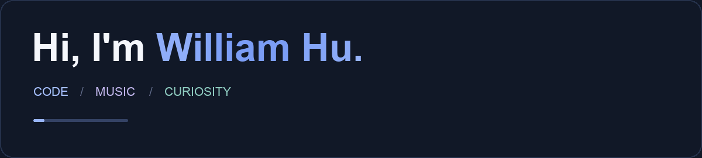

# 

I'm **Jingwen Hu / 胡竞文**, a programmer, creator, and founder of [Exabyte Technologies](https://github.com/Exabyte-Technologies). I write code, play piano, and enjoy turning a small “what if?” into something people can use, hear, or play with.

[Personal website](https://williamhu.tech) · [Exabyte Technologies](https://exabyte.org.cn) · [Email me](mailto:jingwen.hu@exabyte.org.cn)

## 

I like exploring where software, AI, and music meet. My projects range from a browser desktop that generates apps to rhythm games, learning resources, and tools that make everyday tasks easier.

I enjoy figuring things out with other people, whether that means building a useful tool, experimenting with sound, or bringing a creative idea to life.

**Python** is my primary programming language. I also work with **JavaScript, Swift, C++, and AppleScript**, alongside **HTML and CSS** for the web.

## 

| Project | What it's about |
| --- | --- |
| [WhaOS](https://github.com/hujingwen1025/WhaOS) | A browser desktop with built-in tools and AI-powered app generation. |
| [Rhythm Cook](https://github.com/hujingwen1025/Rhythm-Cook) | A cooking rhythm game with 20 levels and music synthesized live in the browser. |
| [Resona](https://github.com/Exabyte-Technologies/Resona) | An adaptive music application I co-created, combining procedural audio with AI-powered customization. |
| [Sonora / 声息](https://github.com/hujingwen1025/Sonora) | A continuous sound space exploring synthesized audio and feedback-driven adjustments for relaxation and focus. |
| [CAICP Academy](https://github.com/hujingwen1025/CAICP-Academy) | An independent bilingual learning resource with lessons, interactive labs, practice, and a mistake notebook. |
| [Dorm Pass Manager](https://github.com/Exabyte-Technologies/Dorm-Pass-Manager) | An Exabyte project bringing pass requests, approvals, and sign-ins into one system. |

[Explore more of my repositories →](https://github.com/hujingwen1025?tab=repositories)

## 

I founded **Exabyte Technologies** around a simple idea: technology should be safer, more convenient, and more approachable. Our public projects span music experiences, everyday software, printing tools, and websites.

[See our work on GitHub →](https://github.com/Exabyte-Technologies)

## 

Away from the screen, I enjoy **piano, making and editing videos, soccer, and basketball**. I'm also happy to sit down for a game of **chess, UNO, or another board game**.

Have an idea to share or something to build together? [Say hello](mailto:jingwen.hu@exabyte.org.cn).

---

*A little code. A little music. A lot of curiosity.*
